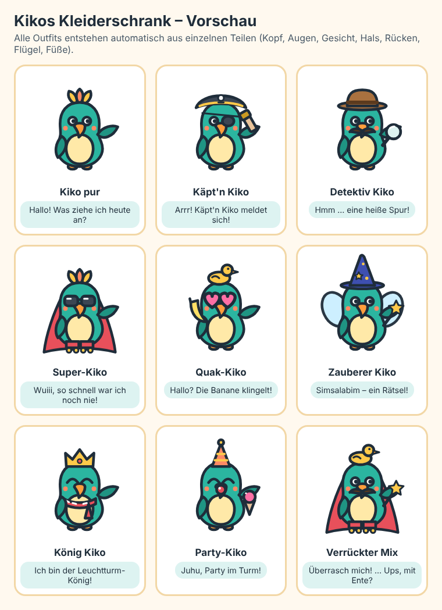

# 12 – Kikos Rätselturm

> **Status: freigegeben** (2026-10-10). Bei Widersprüchen mit `01`–`11` gilt dieses Dokument (höhere Nummer). Beispieltexte (Wissensfragen, Witze, Fälle) sind Entwürfe und werden bei der Umsetzung geprüft und ergänzt.

Der Rätselturm ist ein eigener Bereich für Kinder, die gern knobeln: Sudoku, typische Kinderrätsel und Wissensfragen. Er ist unabhängig von den Stationen. Ein Kind kann jederzeit dorthin, ohne vorher Rechenaufgaben zu lösen. Es gelten alle Regeln aus `CLAUDE.md`: keine Zeitlimits, kein Rot, keine Strafen, keine Streaks, offline, alles druckbar, was sich drucken lässt.

## 1. Ziele

- **Freude am Denken:** Rätsel, die Kinder von 5 bis 8 Jahren ohne Hilfe schaffen können, mit spürbaren Aha-Momenten.
- **Neugier stillen:** Wissensfragen mit einem kurzen „Wusstest du?“-Satz nach jeder Antwort. Das Kind lernt bei jeder Frage etwas, auch wenn es geraten hat.
- **Sichtbarer Fortschritt ohne Druck:** Der Turm wächst mit jedem gelösten Rätsel. Nichts geht verloren.
- **Selbstbestimmt:** Das Kind wählt Rätselart und Schwierigkeit selbst.

## 2. Platz in der App

**Untere Navigation mit 4 Tabs** (ändert `01`, Abschnitt 4): **Abenteuer** · **Üben** · **Rätsel** (Icon: Leuchtturm) · **Schätze**. Die Tabs bleiben mindestens 56 px hoch. Die Tab-Namen werden nicht vorgelesen (Wunsch der Eltern, siehe `ENTSCHEIDUNGEN.md`).

Route `/raetsel` (Turm), `/raetsel/:art` (Spiel). Die Rätsel aus `10` (Muster, Waage, Zahlenmauer, Rechendreieck, Zahlenschloss, Logik) erscheinen zusätzlich im Turm. Im Üben-Thema „Rätsel“ und als Bonus-Rätsel bleiben sie unverändert.

### Bildschirm „Kikos Rätselturm“

```
┌──────────────────────────────┐
│  [Turm mit Etagen, Lampen]   │  ← wächst mit jedem gelösten Rätsel
│  „Noch 2 Lampen bis zur      │
│   nächsten Etage!“           │
├──────────────────────────────┤
│  Kiko im Nest (mit Kostüm)   │
├──────────────────────────────┤
│  Was möchtest du knobeln?    │
│  [Sudoku] [Memory] [Was passt│
│  nicht?] [Schatten] [Labyrinth]
│  [Punkte verbinden] [Bilder- │
│  rätsel] [Geheimschrift]     │
│  [Detektivfall] [Wissensfragen]
│  [Muster & Co.]              │
└──────────────────────────────┘
```

Kacheln wie im Üben (Icon + Name, bei Stufe 1–2 ein Wort). Rätselarten, die es auf der Stufe nicht gibt, erscheinen nicht.

## 3. Rätselarten

| Art | Name im Spiel | Stufe 1 (≈5) | Stufe 2 (≈6) | Stufe 3 (≈7) | Stufe 4 (≈8) |
|---|---|---|---|---|---|
| `sudoku` | Sudoku | Bilder 4×4 | Bilder oder Zahlen 4×4, Münz-Sudoku | Zahlen 4×4 schwer, 6×6 leicht, Münz-Sudoku | 6×6, Rechen-Sudoku 4×4 |
| `memory` | Memory | 6 Paare, gleiche Bilder | 8 Paare, gleiche Bilder | 8 Paare, Rechnung ↔ Ergebnis (bis 20) | 10 Paare, Betrag ↔ Münzen |
| `odd` | Was passt nicht? | 4 Bilder, eins passt nicht | 4 Bilder | 4 Wörter oder Zahlen (z. B. gerade/ungerade) | 4–5 Wörter oder Zahlen |
| `shadow` | Schattenrätsel | 3 Schatten | 3 Schatten | 4 Schatten, auch gedreht | 4 Schatten, gespiegelt/gedreht |
| `maze` | Labyrinth | einfaches Labyrinth 5×5 | 6×6 | Münzpfad: Weg mit genau 1 € | Münzpfad mit Betrag bis 5 € |
| `nonogram` | Bilderrätsel | – | – | 5×5, ein Bild erscheint | 6×6 oder 7×7 |
| `dots` | Punkte verbinden | 1–10 | 1–20 | 1–30, auch in Zweierschritten | 1–50, in Fünfer- oder Zehnerschritten |
| `cipher` | Geheimschrift | – | – | Symbol → Buchstabe, kurze Wörter | kurze Sätze, auch Zahl → Buchstabe |
| `case` | Detektivfall | – | 3 Rätsel, Bildhinweise | 4 Rätsel | 5 Rätsel |
| `quiz` | Wissensfragen | 3 Bildantworten, vorgelesen | 3 Antworten | 3–4 Antworten | 4 Antworten |
| (aus `10`) | Muster & Co. | wie `10` | wie `10` | wie `10` | wie `10` |

Die Grenzen stehen in `levels.ts` (`tower` je Stufe, Regel 8). Die Tabelle beschreibt die Startwerte.

### 3.1 Sudoku

- **Bilder-Sudoku:** Muschel, Stern, Fisch, Krebs (die Symbole aus dem Zahlenschloss). Ohne Lesen spielbar.
- **Zahlen-Sudoku:** 4×4 (Kästen 2×2) und 6×6 (Kästen 2×3). 9×9 gibt es bewusst nicht, das ist für 5–8 Jahre zu groß fürs Handy.
- **Münz-Sudoku:** 1, 2, 5, 10 Cent als Symbole (4×4). Verbindet Sudoku mit dem Geldthema.
- **Rechen-Sudoku (Stufe 4):** 4×4 mit umrandeten Kästen und kleiner Summe in der Ecke („7“). Die Summen helfen beim Lösen.
- **Regel im Spiel (vorgelesen):** „In jeder Reihe, jeder Spalte und jedem Kasten kommt jedes Bild genau einmal vor.“
- **Schwierigkeit über 1–3 Sterne:** mehr oder weniger leere Felder. Alle Rätsel sind **ohne Raten lösbar**: Es gibt immer ein Feld, das sich sicher füllen lässt.
- **Bedienung:** Feld antippen → unten große Knöpfe mit den Symbolen (56 px). Nochmal tippen ändert das Feld, ein Radiergummi leert es. Ab Stufe 3 gibt es zuschaltbare **Notizen** (kleine Merkzahlen).
- **Prüfen:** wie bei der Zahlenmauer (`10`, Abschnitt 3). Richtige Felder bekommen ✓ und sind fest. Die anderen bleiben bearbeitbar. Nie Rot. Eine fertig richtige Reihe leuchtet kurz auf.
- **Speichern:** Ein halb gelöstes Sudoku bleibt erhalten, bis es fertig ist oder das Kind „Neues Rätsel“ wählt.

### 3.2 Memory

- Karten verdeckt im Raster. Zwei aufdecken: Passen sie, bleiben sie offen. Sonst drehen sie sich nach einer Sekunde wieder um. Es gibt kein Zählen der Versuche.
- Paare ab Stufe 3 sind „Rechnung ↔ Ergebnis“ („3 + 4“ ↔ „7“), ab Stufe 4 „Betrag ↔ Münzen“ („1,50 €“ ↔ 1 € + 50 Cent).
- Bei Stufe 1 und 2 nur Bilder (Sachen-Icons, Tiere).
- **Zu zweit:** Vor dem Start wählt man „allein“ oder „zu zweit“. Zu zweit wechseln sich zwei Spieler ab (zwei Profile oder Kind und Erwachsener). Ein Avatar oben zeigt, wer dran ist. Es gibt **keinen Gewinner**: Beide sammeln die Paare in einen gemeinsamen Schatz, am Ende heißt es „Ihr habt alle Paare gefunden!“. Die Lampe bekommt das aktive Profil.

### 3.3 Was passt nicht?

- 4 Karten, eine gehört nicht dazu. Nach der Antwort erklärt Kiko den Grund: „Apfel, Banane und Birne sind Obst. Die Möhre ist ein Gemüse.“
- Kategorien aus einer festen Liste (Obst, Gemüse, Meerestiere, Vögel, Fahrzeuge, Kleidung, Werkzeuge, Münzen ↔ Scheine; ab Stufe 3 Zahlen: gerade/ungerade, Zehnerzahlen).
- Antwortkarten wie `choice`.

### 3.4 Schattenrätsel

- Ein Bild (Sachen- oder Tier-Icon) und 3–4 schwarze Schatten. „Welcher Schatten gehört zum Bild?“
- Falsche Schatten sind andere, ähnliche Formen. Ab Stufe 3 ist der richtige Schatten auch gedreht, ab Stufe 4 gespiegelt.
- Die Schatten entstehen aus den vorhandenen Icons (alle Flächen und Linien schwarz). Es braucht keine neuen Zeichnungen.

### 3.5 Labyrinth und Münzpfad

- **Labyrinth (Stufe 1–2):** Kiko soll zur Truhe. Das Kind tippt Feld für Feld den Weg. Wände sind dicke Linien. Generiert, es gibt genau einen Weg.
- **Münzpfad (Stufe 3–4):** Auf den Feldern liegen Münzen. „Finde einen Weg zur Truhe, auf dem die Münzen zusammen genau 1 € ergeben.“ Die laufende Summe steht unten wie beim Münz-Tablett. Ein Tipp hebt das nächste richtige Feld hervor.

### 3.6 Bilderrätsel (Nonogramm, Stufe 3–4)

- Ein Raster mit Zahlen am Rand: „2 1“ heißt 2 Kästchen, Lücke, 1 Kästchen. Kästchen antippen zum Ausmalen, nochmal tippen setzt einen Punkt (sicher leer).
- Am Ende erscheint ein Bild aus der Insel-Welt (Kiko, Schiff, Palme, Truhe, Fisch …) und es wird farbig. Die Bilder stehen als feste Liste in `src/content/` (5×5 bis 7×7), jedes eindeutig lösbar.

### 3.7 Punkte verbinden

- Nummerierte Punkte in der Reihenfolge antippen. Jede Verbindung wird als Linie gezeichnet. Am Ende entsteht ein Bild (Schiff, Kiko, Seestern …), das farbig wird.
- Ab Stufe 3 auch in Schritten: „Verbinde 2, 4, 6 …“ bzw. Fünfer und Zehner auf Stufe 4. Das übt nebenbei die Zahlenreihe.
- Tippt das Kind einen falschen Punkt, passiert nichts außer einem kurzen Wackeln des richtigen nächsten Punkts. Es gibt keine Fehlermeldung.
- Die Bilder sind feste Daten (Punktlisten) in `src/content/`.

### 3.8 Geheimschrift (Stufe 3–4)

- Kiko schickt eine Nachricht in Symbolschrift („★ ◆ ●“). Oben steht die Schlüsseltabelle (Symbol → Buchstabe). Das Kind tippt unter jedes Symbol den Buchstaben.
- Die Nachrichten sind kurz und lustig: „SCHATZ IM SAND“, „KIKO MAG KEKSE“. Am Ende liest Kiko die Nachricht laut vor.
- Stufe 4: auch Zahl → Buchstabe (A = 1, B = 2 …) als Schlüssel.
- Die Nachrichten sind eine feste, geprüfte Liste. Die Symbolzuordnung wird pro Rätsel neu gemischt.

### 3.9 Detektivfall (Stufe 2–4)

**Idee:** Kiko wird Detektiv, das Kind ist sein Partner. Ein Fall ist eine kleine, spannende, aber nie gruselige Geschichte über 3–5 Rätsel.

**Ablauf**
1. **Fallakte öffnen:** Eine Akte mit Stempel „Geheim!“ klappt auf. Titel, ein Bild vom Tatort und ein Satz, alles vorgelesen. Beispiel: „Krümels Keks ist verschwunden! Nur ein paar Krümel liegen im Sand.“
2. **Verdächtige:** 3 (Stufe 2) bzw. 4 (Stufe 3–4) Tiere als Karten mit Namen, etwa Möwe Mia, Robbe Rudi, Flamingo Fine, Krebs Kalle. Jede Karte hat ein auffälliges Merkmal (Federn, Schwanz, Scheren, nasse Füße).
3. **Hinweistafel:** eine Pinnwand mit leeren Hinweis-Zetteln. Jedes gelöste Rätsel pinnt einen Zettel an, etwa „Am Tatort liegt eine weiße Feder.“ Die Verdächtigen, die nicht mehr passen, bekommen mit einer kleinen Wisch-Animation den Stempel „Entlastet“ (nie rot). Auf Stufe 2 sind die Hinweise Bilder mit kurzem Satz (Feder, Fußspur), ab Stufe 3 auch Sätze wie „Der Täter hat keine Scheren.“
4. **Die Rätsel** kommen aus dem Turm und passen zur Stufe: Sudoku-Ausschnitt, Was passt nicht?, Geheimschrift (die Botschaft ist selbst ein Hinweis), Logik, Muster. Zwischen den Rätseln sagt Kiko kurze Detektivsätze („Hmm, eine Spur! Wir kommen der Sache näher.“).
5. **„Ich weiß es!“:** Bleibt ein Verdächtiger übrig, tippt das Kind auf ihn. Ein falscher Tipp ist kein Fehler: Kiko zeigt auf den passenden Hinweis („Schau mal, der Täter hat keine Scheren“).
6. **Auflösung:** eine kurze, lustige und freundliche Szene. Niemand ist böse: „Möwe Mia wollte den Keks nur mit ihren Küken teilen. Krümel backt einfach neue, für alle!“ Dann kommt der Stempel „Fall gelöst!“, ein Eintrag im **Detektivbuch** und eine Lampe im Turm.

**Belohnung:** Wer den ersten Fall löst, bekommt für Kiko den **Detektivhut mit Lupe** (Abschnitt 4.1).

**Fälle zum Start (6, feste Geschichten in `src/content/cases/`):**

| Titel | Worum es geht | Auflösung (harmlos) |
|---|---|---|
| Der verschwundene Keks | Krümels Keks ist weg | Möwe Mia wollte teilen |
| Die bemalte Muschel | Über Nacht ist eine Muschel bunt angemalt | Flamingo Fine wollte Kiko überraschen |
| Nasse Fußspuren im Leuchtturm | Wer war im Leuchtturm? | Robbe Rudi hat Schutz vor dem Regen gesucht |
| Wo ist Kikos Feder? | Kikos schönste Feder fehlt | Krebs Kalle hat sie als Segel für sein Floß benutzt |
| Der Geheimbrief im Sand | Ein Brief in Geheimschrift (Botschaft entschlüsseln) | Eine Einladung zu Kikos Überraschungsfest |
| Die Glocke um Mitternacht | Wer läutet die Turmglocke? | Der Wind und ein neugieriger Seestern |

- Jeder Fall ist logisch sauber: Die Hinweise schließen alle bis auf einen Verdächtigen aus (Test).
- Die Rätsel im Fall werden je Stufe neu erzeugt. Fälle lassen sich wiederholen, die Rätsel sind dann neu.
- Ein angefangener Fall wird gespeichert, samt Hinweistafel.

### 3.10 Wissensfragen („Kikos Wissenskiste“)

- **Themen:** Tiere · Meer · Natur und Wetter · Mein Körper · Weltall · Welt und Alltag (inklusive Geld). Das Kind wählt ein Thema oder „Gemischt“.
- **Runde:** 5 Fragen. Stufe 1–2: 3 Antworten mit Bildern, alles wird vorgelesen. Stufe 3–4: 3–4 Antworten als Text.
- **Nach jeder Antwort** kommt ein „Wusstest du?“-Satz mit dem Fakt. Bei einer falschen Antwort sagt Kiko: „Fast! Probier es noch einmal.“ Beim zweiten Fehlversuch kommt ein Tipp, danach die Lösung mit Erklärung. Wie überall gibt es keine Strafen.
- **Wissensbuch:** Jede beantwortete Frage legt eine **Wissenskarte** in das Wissensbuch (in den Schätzen). Pro Thema ist eine Seite zu füllen. Gerade für Kinder, die Wissen sammeln, ist das ein starker Anreiz.
- **Inhalte:** fester, geprüfter Fragenkatalog in `src/content/quiz/` (keine Generatoren), anfangs etwa **120 Fragen** (20 pro Thema), jede mit Stufenbereich, Antworten, Fakt-Satz und optionalem Bild. Jede Frage wird vor der Aufnahme auf Richtigkeit geprüft und in einfacher Sprache formuliert.

**Beispiele (Entwurf, zur Prüfung):**

| Thema | Stufe | Frage | Antworten (✓ richtig) | Wusstest du? |
|---|---|---|---|---|
| Tiere | 1–4 | Wie viele Beine hat eine Spinne? | 6 · ✓ 8 · 10 | Spinnen haben acht Beine. Käfer und andere Insekten haben sechs. |
| Meer | 1–4 | Wie viele Arme hat ein Oktopus? | 4 · 6 · ✓ 8 | Ein Oktopus hat acht Arme. An jedem Arm sitzen viele Saugnäpfe. |
| Meer | 2–4 | Welches Tier atmet Luft wie wir? | Hai · ✓ Delfin · Thunfisch | Delfine sind Säugetiere. Sie kommen zum Atmen an die Wasseroberfläche. |
| Tiere | 2–4 | Wie schläft eine Fledermaus? | ✓ kopfüber hängend · im Nest · im Wasser | Fledermäuse hängen sich mit den Füßen auf und schlafen kopfüber. |
| Natur | 1–4 | Welche Jahreszeit kommt nach dem Winter? | Sommer · ✓ Frühling · Herbst | Nach dem Winter kommt der Frühling. Dann blühen die ersten Blumen. |
| Natur | 2–4 | Was braucht eine Pflanze zum Wachsen? | ✓ Wasser und Licht · nur Sand · Schokolade | Pflanzen brauchen Wasser, Licht und gute Erde. |
| Körper | 1–4 | Womit riechen wir? | Ohren · ✓ Nase · Augen | Mit der Nase riechen wir. Sie hilft auch beim Schmecken. |
| Körper | 3–4 | Wie viele Milchzähne hat ein Kind, wenn alle da sind? | 10 · ✓ 20 · 32 | Ein Kind hat 20 Milchzähne. Später wachsen bis zu 32 bleibende Zähne. |
| Weltall | 2–4 | Welcher Stern ist uns am nächsten? | Polarstern · ✓ die Sonne · der Mond | Die Sonne ist ein Stern. Der Mond ist kein Stern, er wird von der Sonne angestrahlt. |
| Weltall | 3–4 | Welcher Planet ist der größte in unserem Sonnensystem? | Erde · Mars · ✓ Jupiter | Jupiter ist so groß, dass mehr als tausend Erden hineinpassen würden. |
| Welt | 2–4 | Wie heißt die Hauptstadt von Deutschland? | München · ✓ Berlin · Hamburg | Berlin ist die Hauptstadt und die größte Stadt Deutschlands. |
| Welt | 1–4 | Welche Münze ist am meisten wert? | 50 Cent · 1 € · ✓ 2 € | Die 2-Euro-Münze ist die wertvollste Münze. Danach kommen die Scheine. |

### 3.11 Muster & Co.

Die Rätsel aus `10` als Kachel im Turm, gemischt aus `STUFEN[stufe].riddles.types`.

## 4. Motivation

1. **Kiko verkleiden und sein Nest einrichten (zentrale Belohnung):** siehe Abschnitt 4.1.
2. **Der Turm wächst:** Jedes gelöste Rätsel und jede Runde Wissensfragen zündet **eine Lampe** an. 5 Lampen ergeben eine **Etage**. Mit jeder neuen Etage wird der Turm höher, Kiko fliegt eine Etage nach oben und es gibt eine kurze Animation (bei `prefers-reduced-motion` ohne Bewegung). Ganz oben (nach 10 Etagen) leuchtet das Leuchtfeuer über der Insel. Danach geht es mit „Sternenetagen“ weiter, es gibt kein Ende und kein Zurück.
3. **Rätselpass:** ein Stempel pro Rätselart beim ersten Lösen, ein goldener Stempel nach 10 gelösten Rätseln dieser Art. Er lädt ein, Neues auszuprobieren.
4. **Wissensbuch:** gesammelte Wissenskarten, nach Themen sortiert, jederzeit wieder ansehen und vorlesen lassen (Abschnitt 3.10).
5. **Kikos Witzekiste:** siehe Abschnitt 4.2.
6. **Selbst gewählte Herausforderung:** 1–3 Sterne pro Rätsel („leicht · mittel · knifflig“). Für knifflige Rätsel gibt es keine Extrapunkte, nur das gute Gefühl und Kikos Lob („Wow, das war ein kniffliges!“).
7. **Rätsel des Tages:** Kiko schlägt jeden Tag eine Rätselart vor („Heute habe ich ein Schattenrätsel für dich!“). Es gibt keinen Zähler für aufeinanderfolgende Tage und keinen Verlust, wenn ein Tag ausfällt.
8. **Aha-Momente:** Reihen im Sudoku leuchten auf, das Bild im Bilderrätsel und beim Punkte-Verbinden wird farbig, die Truhe am Ende des Labyrinths springt auf, Kiko liest die entschlüsselte Geheimbotschaft vor.

Bewusst nicht dabei: Töne und Musik (sie stören, wenn mehrere Kinder im Raum spielen; später als Option möglich), Ranglisten, Punktestände, Zeitmessung.

Die Belohnungen erscheinen in den Schätzen (`01`, 5.8) in einem neuen Abschnitt „Rätselturm“.

### 4.1 Kikos Kleiderschrank und Nest

**Ziel:** Das soll das Highlight sein. Kinder sollen lachen, Kiko „ihr“ Aussehen geben und sich auf das nächste Teil freuen.



*Erste Vorschau (Entwurf): Jedes Outfit entsteht automatisch aus einzelnen Teilen. Die finalen Zeichnungen werden im Stil von `02` verfeinert.*

**Wie man Teile bekommt**
- Das **erste Teil gibt es sofort** nach dem ersten gelösten Rätsel im Turm, damit das Prinzip gleich verstanden wird. Danach gibt es eins mit jeder neuen Etage (Etage 1 nach 3 Lampen, danach alle 5).
- **Auswahl statt Zufall:** Bei jeder neuen Etage öffnet sich eine Truhe mit **zwei Teilen zur Wahl** (meist eins für Kiko, eins fürs Nest). Das andere Teil kommt später wieder. Es gibt keine Überraschungstüten und kein Glücksspiel.
- **Besondere Teile** gibt es für besondere Momente: Detektivhut und Lupe für den ersten gelösten Fall, Doktorhut für 20 Wissenskarten, Krone für das Leuchtfeuer (Etage 10), Zauberhut für den goldenen Stempel im Rätselpass.
- Noch nicht freigeschaltete Teile sind als **graue Umrisse mit „?“** zu sehen, mit einem Hinweis wie „Noch 2 Lampen“. Das macht neugierig.

**Kiko verkleiden: Plätze und Teile** (anfangs 30 Teile, alle kombinierbar)

| Platz | Teile (Beispiele, viele davon lustig) |
|---|---|
| Kopf | Piratenhut, Krone, Zauberhut mit Sternen, Wikingerhelm, Kochmütze, Partyhütchen, Astronautenhelm, Ananas als Hut, Gummiente auf dem Kopf, Detektivhut |
| Augen | Sonnenbrille, riesige Herzbrille, Taucherbrille mit Schnorchel, Augenklappe, Monokel |
| Gesicht | Schnurrbart (geschwungen), Clownsnase, Glitzer-Wangen |
| Hals | Schal, Fliege, Blumenkette, Medaille, Halstuch |
| Rücken | Superhelden-Umhang, Feenflügel, Rucksack, Schwimmring |
| Flügel („Hand“) | Lupe, Zauberstab, Eistüte, Banane als Telefon, Fernrohr, Fähnchen |
| Füße | Gummistiefel, Rollschuhe, Flossen, Ballettschuhe |

- **Jedes Teil hat einen Kiko-Spruch**, der beim Anziehen vorgelesen wird: Piratenhut „Arrr! Käpt'n Kiko meldet sich!“, Banane „Hallo? Hier spricht Kiko … die Banane klingelt!“, Gummiente „Quak! Äh … ich meine: Hallo!“, Rollschuhe „Wuiii, so schnell war ich noch nie!“.
- **Lustige kleine Bewegungen:** Beim Anziehen hüpft Kiko kurz, Feenflügel flattern, die Gummiente wackelt. Bei reduzierter Bewegung steht alles still.
- **Würfel-Knopf „Überrasch mich!“:** zieht Kiko ein zufälliges Outfit aus den freigeschalteten Teilen an. Kinder lieben verrückte Kombinationen.
- **Kiko trägt sein Outfit überall:** auf der Karte, im Kiko-Sheet, im Stationsabschluss, auf der Urkunde (als Kontur) und im Turm. So begleitet das selbst gewählte Aussehen das Kind durch die ganze App.

**Kikos Nest im Turm** (anfangs 20 Teile)

Das Nest ist ein gemütliches Zimmer ganz oben im Turm mit festen Plätzen: Boden, Wand links, Wand rechts, Decke, Fenster und ein Platz für ein Haustier.

| Platz | Teile (Beispiele) |
|---|---|
| Boden | Teppich (Welle, Stern), Schatzkiste, Sitzkissen, Mini-Pool |
| Wand | Bilderrahmen (zeigt die gelösten Bilderrätsel!), Piratenflagge, Bücherregal (öffnet das Wissensbuch), Uhr mit Fisch |
| Decke | Lichterkette, Sternenmobile, Discokugel (glitzert, ohne Ton), Hängematte |
| Fenster | Vorhänge, Fernrohr, Blumenkasten |
| Haustier | kleiner Krebs, Goldfisch im Glas, Schildkröte, Glühwürmchen. Das Haustier blinzelt und bewegt sich ab und zu, und es freut sich, wenn das Kind zurückkommt. |

- Manche Nestteile sind **nützlich und witzig zugleich:** Das Bücherregal öffnet das Wissensbuch, die Witzekiste auf dem Regal die Witze-Sammlung, der Bilderrahmen zeigt das zuletzt aufgedeckte Bild.
- Teile werden einfach angetippt und landen auf ihrem Platz. Nochmal tippen nimmt sie weg. Es gibt kein Ziehen und kein Herumschieben, das ist für 5-Jährige zu fummelig.

**Kleiderschrank-Bildschirm** (`/raetsel/kiko`)

```
┌──────────────────────────────┐
│ [Kiko groß, in der Mitte]    │  ← Live-Vorschau, Spruch in Sprechblase
│     [🎲 Überrasch mich!]     │
├──────────────────────────────┤
│ [Kiko] [Nest]                │  ← zwei Reiter
│ Kopf · Augen · Gesicht · …   │  ← Plätze als Icon-Leiste
│ [Hut][Krone][ ? ][ ? ][Ente] │  ← Teile, 72 px, freigeschaltet bzw. „?“
└──────────────────────────────┘
```

**Technik:** Kiko ist schon ein SVG mit festem Körper und wechselnden Posen (`02`, 6.1). Jedes Teil wird als eigene SVG-Gruppe im selben Koordinatensystem (viewBox 96 × 96) gezeichnet und in der richtigen **Ebene** über bzw. unter den Körper gelegt:
- Rücken hinter dem Körper
- dann Körper und Bauch
- Füße
- Hals, Gesicht, Augen
- Kopf (Hüte verdecken den Schopf teilweise; jeder Hut legt fest, ob der Schopf oben herausschaut)
- Flügel-Teile zuletzt

Teile für den Flügel hängen an einem Ankerpunkt, der je Pose definiert ist, damit die Lupe auch beim Winken in der Hand bleibt. So entsteht jede Kombination automatisch, ohne einzelne Bilder pro Outfit. Das Nest funktioniert genauso: eine Zimmer-Zeichnung mit festen Plätzen, auf die die Teile gelegt werden. Alles bleibt Vektorgrafik, scharf auf jedem Bildschirm, offline und klein. Im Druck erscheinen die Teile als Kontur.

### 4.2 Kikos Witzekiste

**Ziel:** Ein kleiner Lacher als Belohnung nach jeder Runde, und etwas, das Kinder stolz weitererzählen.

- **Nach jeder geschafften Runde** im Turm (und nach einer Station im Abenteuer) springt die **Witzekiste** auf: Kiko hält ein Kärtchen hoch und liest die Frage vor.
- Das Kind darf **raten**, laut, es wird nichts eingegeben. Dann tippt es auf **„Auflösen!“**. Kiko lacht (Pose `freut-sich`, Sprechblase „Hihihi!“, die Federn wackeln), und die Antwort wird vorgelesen.
- Darunter stehen zwei Knöpfe: **„Nochmal vorlesen“** und **„Erzähl ihn weiter!“**. Der zweite zeigt den Witz groß an, zum Vorlesen für Eltern oder Geschwister.
- **Witzebuch** in den Schätzen: Jeder gehörte Witz kommt hinein, sortiert nach Tierwitze, Meereswitze, Scherzfragen und Piratenwitze. Hier lassen sich alle Witze wieder anhören. Ein Lieblingswitz lässt sich mit einem Herz markieren.
- **Altersgerecht:** Jeder Witz hat einen Stufenbereich. Wortspiele, die Lesen oder Wortwissen brauchen, gibt es erst ab Stufe 3. Es gibt keine gemeinen Witze, keine Witze über Menschen oder Aussehen und nichts Gruseliges.
- Anfangs sind es etwa **60 geprüfte Witze** in `src/content/jokes.ts`. Es gibt keine Wiederholung, bis alle der Stufe einmal dran waren.

**Beispiele (Entwurf):**

| Stufe | Frage | Antwort |
|---|---|---|
| 1–4 | Was hat Zähne, kann aber nicht beißen? | Ein Kamm! |
| 1–4 | Was hat vier Beine und kann trotzdem nicht laufen? | Ein Tisch! |
| 1–4 | Welcher Hahn kräht nie? | Der Wasserhahn! |
| 2–4 | Was hat einen Hals, aber keinen Kopf? | Eine Flasche! |
| 2–4 | Was ist grün und klopft an die Tür? | Ein Klopfsalat! |
| 2–4 | Welches Tier ist das stärkste? | Die Schnecke. Sie trägt ihr ganzes Haus! |
| 3–4 | Was liegt am Strand und spricht undeutlich? | Eine Nuschel! |
| 3–4 | Was macht ein Pirat am Computer? | Er drückt die Enter-Taste! |
| 3–4 | Was ist ein Keks unter einem Baum? | Ein schattiges Plätzchen! |

## 5. Hilfe

Wie überall (`01`, 5.5): Tipp 1 erklärt die Regel. Tipp 2 ist konkret, beim Sudoku zum Beispiel: Kiko zeigt auf ein Feld, das sich sicher füllen lässt („In dieser Reihe fehlt nur noch ein Bild“). Danach kommt „So geht's“ mit der Lösung. Gelöste Rätsel zählen immer, auch mit Hilfe.

## 6. Gestaltung: kindgerecht und motivierend

- **Eine Sache pro Bildschirm.** Oben das Rätsel, unten die Eingabe (Symbol-Knöpfe im Daumenbereich), dazwischen nichts Ablenkendes.
- **Große Ziele:** Felder und Knöpfe mindestens 56 px. Ein 6×6-Sudoku nutzt auf dem Handy die volle Breite (etwa 56 px pro Feld bei 360 px).
- **Alles vorlesbar,** bei Stufe 1–2 automatisch. Bilder und Symbole statt Text, wo immer es geht.
- **Erster Einstieg ohne Anleitung:** Beim allerersten Rätsel einer Art pulsiert das erste sinnvolle Feld sanft, und Kiko sagt einen Satz („Tipp hier und such ein Bild aus!“). Danach gibt es keine Erklärung mehr. Die Regel steht jederzeit hinter dem Tipp-Knopf.
- **Kleine Erfolge feiern:** Kiko freut sich sichtbar (Pose `freut-sich`), dazu kurzes Leuchten, Konfetti am Ende. Bei `prefers-reduced-motion` gibt es nur den Farbwechsel ohne Bewegung.
- **Lob für Mühe, nicht nur für Erfolg:** wechselnde Sätze wie „Du hast nicht aufgegeben!“ oder „Das war knifflig, und du hast es geschafft.“ (Pools wie in `01`, 5.5.)
- **Kurze Runden:** ein Rätsel bzw. 5 Wissensfragen, etwa 3–5 Minuten. Am Ende steht ein klares „Geschafft! Noch eins?“ mit den Knöpfen „Noch eins“ und „Zum Turm“.
- **Nie eine Sackgasse:** Rückgängig, Hilfe und Pause sind immer da. Angefangenes bleibt gespeichert, und man kann jederzeit ein neues Rätsel nehmen, ohne etwas zu verlieren.
- **Wenige, klare Belohnungen:** Lampen und Etagen, Kiko-Sachen, Wissenskarten, Witze, Rätselpass. Keine Punkte, Münzen oder Zahlenkolonnen.
- **Ruhige Farben** aus dem Designsystem (`02`). Fehler sind nie rot, richtige Felder bekommen ✓ und Palmengrün.

## 7. Datenmodell (Ergänzung zu `03` und `09`)

```ts
type TowerType =
  | 'sudoku' | 'memory' | 'odd' | 'shadow' | 'maze' | 'dots'
  | 'nonogram' | 'cipher' | 'case' | 'quiz' | 'riddles';

interface TowerProgress {
  lamps: number;                         // gelöste Rätsel insgesamt
  solved: Partial<Record<TowerType, number>>;  // für den Rätselpass
  facts: string[];                       // IDs der gesammelten Wissenskarten
  jokes: string[];                       // IDs der gehörten Witze
  outfit: { kiko: string[]; nest: string[] };  // freigeschaltete Teile
  wearing: { kiko?: string; nest: string[] };  // was Kiko gerade trägt, was im Nest steht
  saved?: { type: TowerType; seed: number; stars: 1 | 2 | 3; state: unknown };  // angefangenes Rätsel
}
// Profile bekommt `tower?: TowerProgress` (optional, ohne Migration lesbar).
```

- Neue Antworttypen: `sudoku` (Größe, Kästen, Symbole, Zellen mit `given`), `memory`, `path` (Labyrinth/Münzpfad), `dots`, `nonogram`, `cipher`. Wissensfragen, „Was passt nicht?“, Schatten und die Täterwahl im Detektivfall nutzen `choice`.
- Generatoren in `src/practice/tower/` mit Löser: Sudoku eindeutig und ohne Raten lösbar, Labyrinth mit genau einem Weg, Münzpfad mit mindestens einer Lösung. Feste, geprüfte Daten in `src/content/`: Wissensfragen, Witze, Nonogramme, Punktbilder, Geheimbotschaften, Detektivfälle, Kiko-Kostüme.

## 8. Druck

Die Druckseite (`06`) bekommt die Auswahl „Rätselturm-Blatt“ mit Sudoku (4×4/6×6), Labyrinth, Punkte verbinden, Bilderrätsel, Geheimschrift und „Was passt nicht?“ in der Stufe des Kindes, dazu ein Lösungsblatt. Memory, Detektivfälle und Wissensfragen werden nicht gedruckt.

## 9. Umsetzung in Schritten

1. **Navigation und Turm:** vierter Tab, Turm mit Lampen und Etagen, Kacheln, „Muster & Co.“ aus `10`, Witzekiste mit Witzebuch.
2. **Kleiderschrank und Nest:** Ebenen-System für Kiko, die ersten 30 Kiko-Teile und 20 Nestteile, Truhe mit Auswahl, Sprüche, „Überrasch mich!“, Kiko mit Outfit überall in der App. Vorher eine Bild-Vorschau zur Freigabe.
3. **Sudoku:** Bilder, Zahlen, Münzen (4×4, 6×6), Rechen-Sudoku, Notizen, Speichern.
4. **Wissensfragen:** Katalog (120 Fragen, geprüft), Runden, Wissensbuch.
5. **Memory (allein und zu zweit), Was passt nicht?, Schattenrätsel.**
6. **Labyrinth/Münzpfad, Punkte verbinden, Bilderrätsel.**
7. **Geheimschrift und Detektivfall** (Fallakte, Hinweistafel, 6 Fälle, Detektivbuch).
8. **Rätselpass, Rätsel des Tages, Rätselturm-Druckblatt.**

Jeder Schritt ist ein eigener Pull Request mit Tests (Generatoren: jede Art × Stufe × 300 Seeds, eindeutig lösbar) und einer Prüfung im Handy-Viewport.

## 10. Abnahme

- Ein 5-jähriges Kind kann ein Bilder-Sudoku und ein Memory **ohne Lesen** spielen.
- Jedes generierte Sudoku hat genau eine Lösung und lässt sich ohne Raten lösen (Test).
- Alle Wissensfragen sind sachlich richtig, kindgerecht formuliert und haben genau eine richtige Antwort (Prüfliste bei der Aufnahme). Witze, Geheimbotschaften und Detektivfälle sind freundlich und ohne Angstmomente.
- Memory zu zweit kennt keinen Gewinner.
- Kein Zeitlimit, kein Rot, keine Streaks. Fortschritt im Turm geht nie verloren.
- Alles funktioniert offline und ab 360 px Breite.
